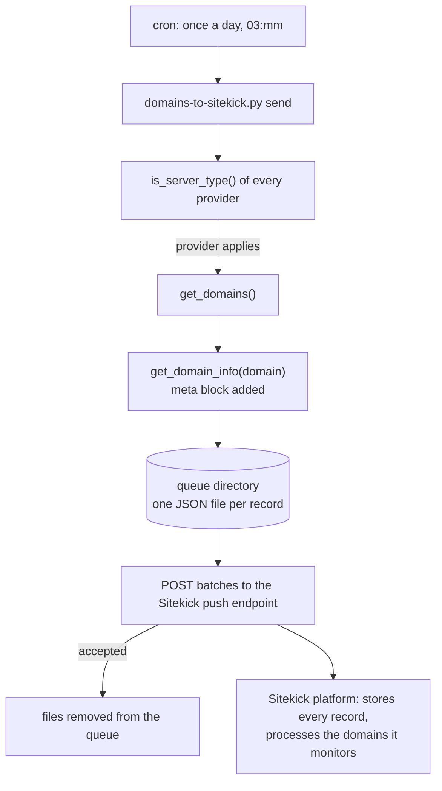

# Server to Sitekick

Server to Sitekick is a small Python script that runs on a hosting server. It collects data about the domains hosted
on the server and about the server itself, and sends that data to the Sitekick hosting intelligence platform. It uses
only the Python standard library.

## Why a hoster runs it

Sitekick collects public data about the domains it monitors: DNS, certificates, the website, its technology and its
performance. What it cannot see from outside is how the hoster provisioned the domain: on which server it lives, which
PHP handler it uses, how many mailboxes it has, which WordPress version and plugins are installed. Server to Sitekick
supplies that data from the hosting server itself, so Sitekick can combine the two views of a domain. The hoster sees,
for example, which websites run an outdated WordPress version. The platform stores the identity of the sending server
with each record; linking servers to the domains they host is designed for.

## Terms

- **Sitekick operator**: the party that runs the Sitekick service you send to. The Sitekick operator provides the push
  URL, defines the diagnostic commands (see [Diagnostic mode](#diagnostic-mode)) and stores the data it receives.
- **Connector**: a definition on the Sitekick platform for one kind of data, such as the hosting data of a domain from
  its Plesk server; see the [Sitekick connectors site](https://yourapi.github.io/sitekick-connectors/).
- **Data point**: one piece of information about a domain, website, server or customer that the platform keeps with
  its history, such as the PHP version of a domain.

## How it works

When the script runs with the `send` command (the default), it:

1. **Detects the providers.** Every Python module in the `providers/` directory is a provider for one kind of
   server. The script calls each provider's `is_server_type()` and uses the providers that answer yes, for example
   `plesk` on a Plesk server.
2. **Lists the domains.** It calls the provider's `get_domains()` for the list of domains on the server.
3. **Collects the domain info.** It calls `get_domain_info(domain)` to collect the information of a domain; the
   collection is designed for one record per domain on the server. The script adds a `meta` block that identifies the
   server and the moment of collection.
4. **Queues the records.** Each record is written as a JSON file to the queue directory (default
   `/tmp/sitekick/domains`; [Installation](installation.md#configuration-file) recommends another location).
5. **Pushes the records.** It sends the queued records in batches to the Sitekick push endpoint, in HTTP POST
   requests. A file is removed from the queue once its batch has been accepted; records that could not be delivered
   stay in the queue and go with the next run. Batches and retries are described in
   [Data sent to Sitekick](data.md#the-request).

The `install` command adds a cron job that runs the script once a day, between 03:00 and 04:00. The minute is derived
from the host name and IP address of the server, so it stays the same for a server while the servers of a hosting
platform are spread over the hour.

## Providers

The repository contains these providers:

| Provider | Applies to | What it sends |
|---|---|---|
| `plesk` | Servers with Plesk, detected with `plesk version` | Designed for one record per domain on the server: the Plesk domain information, the PHP handler, and the WP Toolkit information about a WordPress site |
| `server` | Every Linux server | One record for the server: host name, IP address, MAC address and time; with system information enabled also the output of `uptime`, `free`, `df` and `lscpu` |
| `debug` | Every server | The output of the diagnostic commands that the Sitekick operator lists for this server, see [Diagnostic mode](#diagnostic-mode) |
| `template` | Only its own development host | The starting point for a new provider, see [Writing a provider](providers.md) |
| `test_body` | Only its own development host | A development provider: it generates 10,000 domain names and returns a fixed sample record in the Plesk format for each; designed for testing the push and the receiving side with realistic volumes. Do not use it against a production platform |

The provider mechanism is designed for other control panels as well, such as cPanel and DirectAdmin. Adding one takes
a module with three functions and the constants `DOMAIN_COUNT_PER_POST` and `DOMAIN_POST_INTERVAL`, as in the
template; see [Writing a provider](providers.md).

### Diagnostic mode

The `debug` provider applies to every server. Every run of `send`, including the daily cron run, and every `test all`
therefore also retrieves the diagnostic commands that the Sitekick service lists for this server, matched on host
name, IP address or MAC address, and runs them with the privileges of the script (root under cron). `send` runs every
listed command and sends the output; `test all` runs up to five of them and prints the output. The Sitekick operator
defines these commands.

The `debug` command runs this provider alone. `install debug` schedules the `debug` command every 5 minutes, on
request of the Sitekick operator; running `install` again rewrites the cron file to the daily run. See
[Installation](installation.md#diagnostic-mode).

## What is sent

Every record is a JSON object with the data of the provider and a `meta` block with the provider name, the domain, the
host name, IP address and MAC address of the server, and a timestamp. A Plesk record contains the text output of the
Plesk command-line tools for the domain. That output can contain personal data, such as the name of the owner's contact
and the email address of a WordPress administrator; with `--gdpr-compliant` the script replaces these two values by
pseudonyms and sends the rest as Plesk reports it. [Data sent to Sitekick](data.md) describes every field and how to
limit what is sent.

## Receiving side

On the Sitekick platform, connectors turn the records into data points. The connectors are described on the
[Sitekick connectors site](https://yourapi.github.io/sitekick-connectors/):

- [`sitekick/hosting/domain/plesk`](https://yourapi.github.io/sitekick-connectors/catalogue/hosting-domain/#plesk):
  the hosting data of a domain from its Plesk server, such as the PHP version, the mailboxes and the WordPress
  version, plugins and themes.
- [`sitekick/hosting/server/plesk`](https://yourapi.github.io/sitekick-connectors/catalogue/other/#plesk): designed
  for the identity of the server that pushes the data.

How the platform receives and stores pushed data is described in the Sitekick platform documentation.

## Where to go next

| Page | Read it for |
|---|---|
| [Installation](installation.md) | Requirements, getting the code, the configuration file, the first run, the cron job and checking that data arrives |
| [Commands and configuration](usage.md) | Every command and option, with its default |
| [Data sent to Sitekick](data.md) | The request, the records, the privacy settings and how to limit what is sent |
| [Writing a provider](providers.md) | Adding support for another kind of server |
| [Testing](testing.md) | Unit tests and a local echo server |

The code is available under the Apache License 2.0 at
[github.com/yourapi/server-to-sitekick](https://github.com/yourapi/server-to-sitekick).
